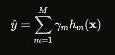
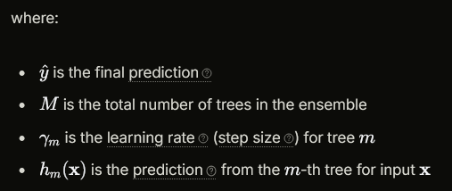
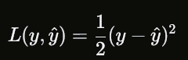
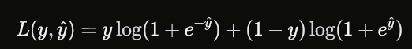
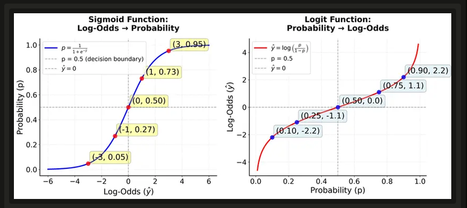
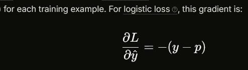
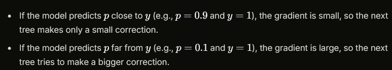
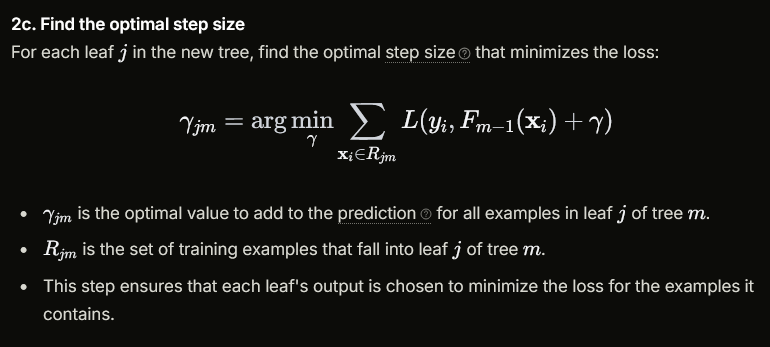

---Boosted Trees---
Unlike Random Forest, which trains trees independently and combines them through voting or averaging, boosted trees train each new tree to correct the mistakes made by the previous trees in the ensemble. This sequential, error-correcting approach allows boosted trees to achieve exceptional predictive performance, often outperforming other machine learning algorithms.

Boosted trees offer several practical advantages and rank among the most accurate machine learning algorithms available.

First, they often achieve state-of-the-art predictive performance across a wide variety of problems, frequently outperforming other algorithms including Random Forest, neural networks, and linear models. This exceptional performance makes boosted trees particularly valuable when accuracy is the primary concern.

Additionally, boosted trees can handle both numerical and categorical features effectively without requiring extensive preprocessing, and they can automatically capture complex non-linear relationships.

The algorithm is also stable to outliers and can handle missing values.

Another significant advantage is that boosted trees provide built-in feature importance measures, allowing you to understand which features are most influential in making predictions.

The algorithm also offers flexibility in the choice of loss functions, making it adaptable to different types of problems (regression, classification, ranking, etc.). Finally, boosted trees can be fine-tuned extensively through hyperparameter optimization, allowing you to achieve optimal performance for your specific problem.

Disadvantages:

On big amount of trees they can be overfited

The sequential nature of the algorithm means that trees cannot be trained in parallel .

Boosted trees are also sensitive to noisy data and outliers, which can cause the algorithm to focus too much on correcting errors that may not be representative of the true underlying pattern. 

Main Logic:

The final boosted tree model is an ensemble of MM decision trees, where each tree is trained sequentially to correct the errors of the previous trees.

  

 Boosted trees minimize a loss function L(y,y^) that measures how well the model's predictions match the true values. Common loss functions include.  
 
 For Regression (Mean Squared Error).
  
 
 For Classification (Logistic Loss).
 

 

 The boosting algorithm computes the gradient of the loss with respect to y^y^​ (where y^y^​ is the log-odds score for the model's prediction, or the raw score output by the model for a given input xx)

 

 

 